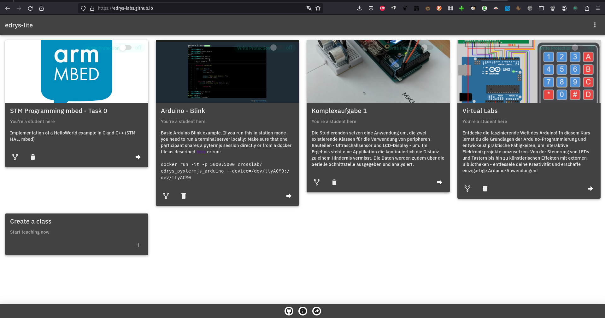

# edrys-Lite: Revolutionizing Remote Laboratories



Welcome to edrys-Lite, the cutting-edge open-source project designed to revolutionize how we create and share remote laboratories. In a world where education and research are increasingly moving online, edrys-Lite provides an intuitive and simplistic way for users to engage with laboratory environments directly from their browser -- no servers required.

## Introduction

Inspired by @edrysorg, which is unfortunately not under active development, edrys-Lite aims to provide a serverless peer-to-peer approach for remote laboratories. By leveraging the latest web technologies, such as WebRTC for real-time, peer-to-peer connections, and CRDTs ([Yjs](https://yjs.dev)) for collision free state handling, edrys-Lite offers a seamless, serverless experience for users worldwide. Where WebRTC is blocked, a classroom can switch to a WebSocket relay instead.

Whether you're a student, educator, researcher, or enthusiast, edrys-Lite invites you to explore, contribute, and grow with us. Together, we can unlock new realms of possibility and innovation in the digital age.

## ✨ Features

- __Live Classrooms:__
  Live chat, create rooms, and interact in different modules

- __Remote Labs:__
  Allow students to interact with your real lab equipment remotely & asynchronously

- __Modular:__
  Build your class by combining Modules or make your own with an easy real-time API

- __Easy to start:__
  Entirely browser-based, no hosting, no backend, no databases or any other dependencies to set up

- __Privacy-friendly:__
  Passwordless auth with autogenerated user-ids, without any tracking or data collection

- __Signed and verified:__
  Every user is a key pair created in the browser. Classroom setup, rooms, chat and presence are signed and checked by every peer, and an optional members list decides who may join and who teaches

- __Fast & Modern:__
  Based on a modern peer-2-peer approach with Conflict-free-Replicated-DataTypes (CRDTs) and deliberately small codebase

- __Free and Open Source, forever:__
  No paywall features or lock-in

## 📸 Demo

https://github.com/edrys-labs/edrys-Lite/assets/3089101/b7188ba0-b91e-469c-8a9f-413229683bcc

## 💡 Use cases

- __Live online teaching:__
  One to one, one to many, and many to many live classrooms

- __Remote Labs:__
  Allow students to access and control live equipment remotely (eg. remote Arduino fleet)

- __Flipped classrooms and blended learning:__
  Create modules to deliver virtually any content asynchronously

- __Group coursework:__
  Dynamic breakout rooms and easy jumping between rooms

## 📚 Documentation

For more information, please refer to the [official documentation](https://github.com/edrys-labs/documentation), also available as a [LiaScript course](https://liascript.github.io/course/?https://raw.githubusercontent.com/edrys-labs/documentation/refs/heads/main/README.md).

## 🛠️ Development

Requires Node.js and npm.

```bash
npm install
npm run watch             # dev server on http://localhost:6999
npm run build             # production build into dist/
npm run websocket-server  # local WebSocket relay, for classrooms using the WebSocket transport
```

Tests:

```bash
npm test                  # unit tests (Vitest)
npm run test:e2e          # end-to-end tests (Playwright) over WebRTC
npm run test:e2e:ws       # the same tests over WebSocket
```

See [tests/e2e-tests/README.md](tests/e2e-tests/README.md) for what the end-to-end tests need.

## 📄 License

[Mozilla Public License 2.0](LICENSE)